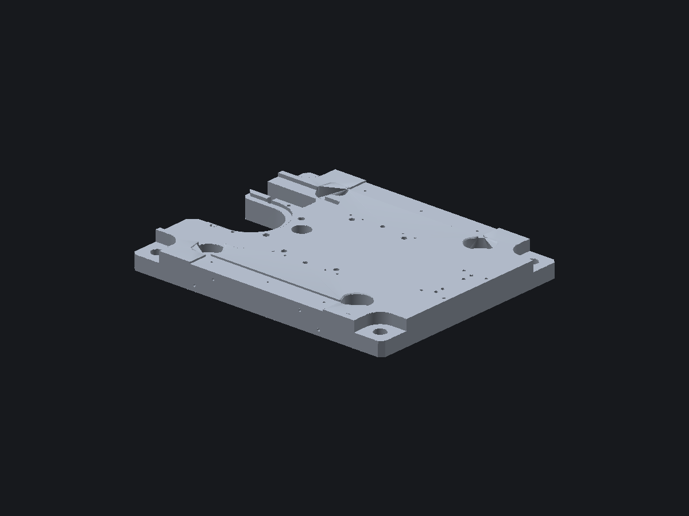

<p align="center">
  
</p>

<h1 align="center">Rohteilcalc</h1>

<p align="center">
  CNC-Rohteilrechner für STEP-Dateien – Bauteil laden, Rohteilmaße berechnen, fertig.
</p>

<p align="center">
  <a href="https://github.com/hannesfox/Rohteilcalc/actions/workflows/main.yml"></a>
  
  
</p>



## Was macht das Programm?

Rohteilcalc liest eine STEP-Datei (`*.step`, `*.stp`) ein, richtet das Bauteil
automatisch an seiner längsten Achse aus und berechnet daraus das passende
Standard-Rohteil. Die 3D-Ansicht zeigt Bauteil und Rohteil-Box direkt
gegenüber.

## Funktionen

- **STEP-Import** inkl. B-rep-Triangulierung (`truck-stepio` / `truck-meshalgo`)
- **Automatische Ausrichtung**: längste Kante → X, mittlere → Y, kürzeste → Z
- **Rohteilberechnung** nach festen Fertigungsregeln
- **3D-Viewport** mit Software-Z-Buffer: keine durchscheinenden Rückseiten,
  weiche Schattierung gekrümmter Flächen, harte Kanten bleiben scharf
- **Bedienung**: STEP über Button laden, per **Drag & Drop** ins Fenster ziehen,
  Kamera mit linker Maustaste drehen, mit dem Mausrad zoomen
- **Fertige Builds**: Windows `.exe` und macOS `.app` (Universal: Apple Silicon + Intel)

## Rohteilregeln

| Achse | Regel |
|-------|-------|
| **X** | Bauteillänge + 5 mm Sägeaufmaß |
| **Y** | Halbzeug-Staffel: bis 25 mm in 5-mm-Schritten, dann 10-mm-Schritte |
| **Z** | Standard-Plattenstärke in 10-mm-Stufen (10, 20, 30, 40, …) |

Die Z-Dicke enthält immer mindestens 4 mm Spannrand unten und 1 mm
Planfräs-Aufmaß oben:

```text
Z_Rohteil = ceil((Z_Bauteil + 5 mm) / 10 mm) * 10 mm
```

## Download

Die aktuellen Builds liegen unter
[**Actions → Build**](https://github.com/hannesfox/Rohteilcalc/actions/workflows/main.yml)
als Artefakt:

- `Rohteilcalc-windows-x64.zip` → enthält `Rohteilcalc.exe`
- `Rohteilcalc-macos-universal.zip` → enthält `Rohteilcalc.app`

Bei einem Tag (`v*`) werden die Pakete zusätzlich als
[Release](https://github.com/hannesfox/Rohteilcalc/releases) veröffentlicht.

### Hinweise zu den Downloads

- **Windows:** Die `.exe` ist nicht signiert. Windows SmartScreen meldet sich
  beim ersten Start – über *Weitere Informationen → Trotzdem ausführen* starten.
- **macOS:** Die App ist nur ad-hoc signiert und nicht notarisiert. Beim ersten
  Start *Rechtsklick → Öffnen* wählen oder das Quarantäne-Attribut entfernen:

  ```bash
  xattr -dr com.apple.quarantine /Applications/Rohteilcalc.app
  ```

## Selbst bauen

Voraussetzung: [Rust](https://rustup.rs) (stable).

```bash
git clone https://github.com/hannesfox/Rohteilcalc.git
cd Rohteilcalc
cargo run --release
```

Release-Binary erzeugen:

```bash
cargo build --release
# macOS:   target/release/rohteil_calc
# Windows: target\release\rohteil_calc.exe
```

### Projektstruktur

```text
.
├── .github/workflows/main.yml   # CI: Windows- und macOS-Build
├── assets/
│   ├── logo.png                 # Logo (Quelle für die App-Icons)
│   ├── icon.ico                 # Windows-Icon (in der .exe eingebettet)
│   ├── icon.icns                # macOS-App-Icon
│   └── screenshot.png
├── build.rs                     # bettet das Icon unter Windows ein
├── src/main.rs                  # App, STEP-Loader, Rasterizer, UI
└── Cargo.toml
```

## Technischer Hintergrund

- **STEP-Parsing:** `truck-stepio`, Triangulierung mit robuster Toleranz (0,05 mm)
- **Rendering:** eigener Software-Rasterizer mit Z-Buffer in eine egui-Textur.
  egui selbst besitzt keinen Tiefenpuffer; ohne ihn würden Rückseiten (z. B.
  Bohrungswände) über die Vorderseite gezeichnet.
- **Schattierung:** Flächennormale mit Glättung über Kanten < 40°, dadurch
  weiche Zylinder-/Kegelflächen bei scharfen Bauteilkanten.

## Lizenz

Dieses Projekt steht unter der [Apache-2.0-Lizenz](LICENSE).
